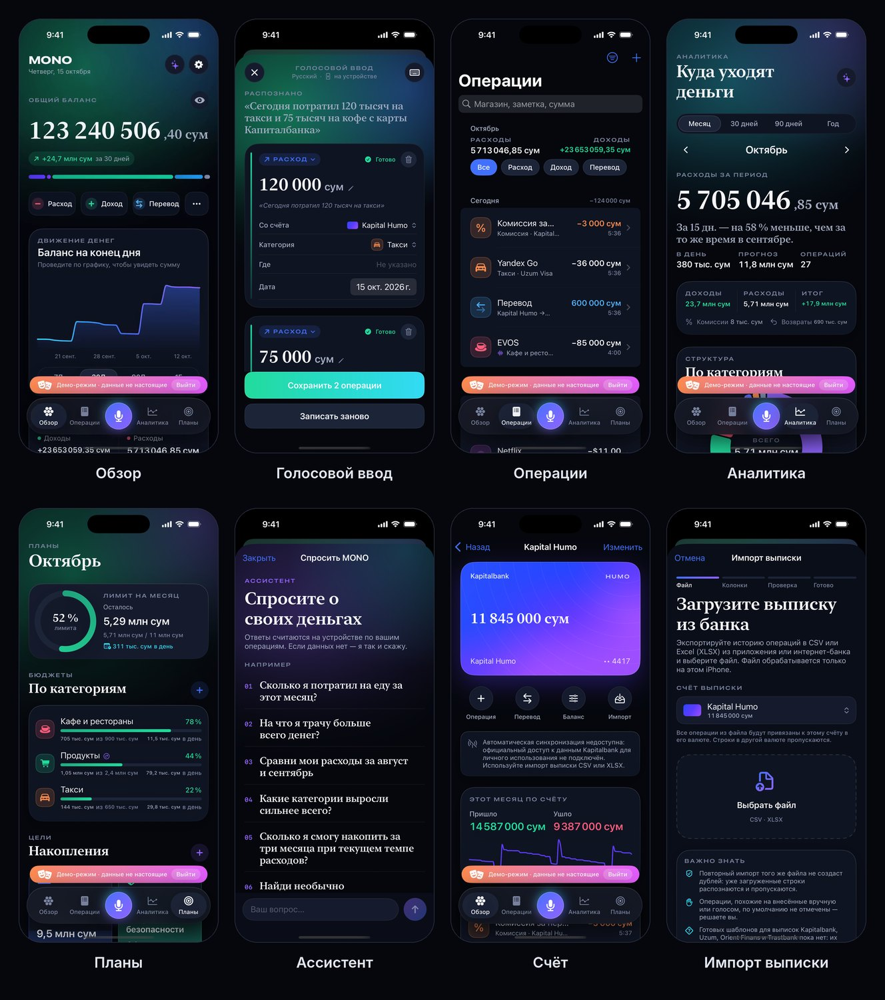

# MONO Finance

Личные финансы на iPhone: счета в банках и наличные, расходы, доходы и переводы, голосовой ввод, аналитика, бюджеты и цели. Нативное приложение на Swift и SwiftUI для iOS 18 и новее, интерфейс на русском. Данные хранятся только на телефоне: без аккаунтов, облака и банковских паролей.



Снимки сделаны в iOS-симуляторе в демо-режиме: данные выдуманы, и приложение показывает это плашкой «Демо-режим · данные не настоящие».

## Коротко

- **Готово:** приложение целиком и ядро учёта — 106 файлов Swift, около 22 000 строк кода. Ядро покрыто 121 автотестом.
- **Проверено:** сборка настоящим Xcode в облаке, снимки экранов и сквозной UI-тест в симуляторе iPhone.
- **Не проверено:** запуск на реальном iPhone. Микрофон, Face ID, уведомления и выбор файлов проверяются только на устройстве.
- **Установка без Mac:** файл `MonoFinance.ipa` из Releases и Sideloadly на Windows — инструкция ниже.

## Знакомство с приложением

**Первый запуск.** Онбординг в три шага: основная валюта → ваши счета с настоящими остатками → защита Face ID или код-паролем. Кнопка «Посмотреть на демо-данных» открывает отдельную демо-базу, которая не смешивается с вашими данными. Выйти из демо — кнопка «Выйти» на плашке.

**Нижняя панель:**

- **Обзор** — общий баланс; кнопки «Расход», «Доход», «Перевод» и меню «…» с импортом выписки; график баланса; итоги месяца; счета и карты; регулярные платежи, ожидающие подтверждения; наблюдения; последние операции. Вверху справа — ассистент и настройки.
- **Операции** — список с поиском и фильтрами. В карточке операции — история изменений и фото чека. Удалённую операцию можно вернуть кнопкой «Вернуть».
- **Микрофон в центре** — голосовой ввод. Скажите, например: «Вчера купил продукты в Корзинке на 245 тысяч и потратил 40 тысяч на такси». Появятся два черновика: проверьте их, при необходимости поправьте и нажмите «Сохранить». Без подтверждения ничего не сохраняется. Фразу можно и напечатать.
- **Аналитика** — куда уходят деньги: категории, динамика, сравнение с прошлым периодом, магазины, обязательные траты, найденные подписки, прогноз накоплений.
- **Планы** — лимит на месяц, бюджеты категорий, цели, крупные запланированные траты, регулярные платежи.

**Быстрые действия.** Долгое нажатие на иконку MONO: «Голосом», «Новый расход», «Перевод», «Спросить MONO». Эти же команды доступны в Siri и «Быстрых командах».

## Что сделано

### Приложение — `MonoFinance/`

SwiftUI, iOS 18: 62 файла, около 13 400 строк.

- **Экраны:** онбординг, обзор, счета (список, карточка, редактор), операции (список, фильтры, детали, редактор с цифровой клавиатурой), голосовой ввод, аналитика, планы (бюджеты, цели, запланированные траты, регулярные платежи), категории и правила для магазинов, импорт выписки, ассистент, настройки (безопасность, речь, ассистент, банки, курсы валют, резервные копии, о приложении).
- **Учёт:** расходы, доходы, переводы между своими счетами, в том числе между валютами; комиссия отдельной операцией; возвраты; корректировка баланса; карты, вклады, кредитные карты; архив счетов.
- **Голос:** Apple Speech на устройстве с живой расшифровкой. Разбирает несколько операций в одной фразе, числа словами, даты вроде «вчера», магазин, категорию и счёт по названию банка. Разбор русских и узбекских фраз покрыт тестами. Если локального распознавания на устройстве нет, приложение просит согласие на серверы Apple или предлагает ввести фразу текстом.
- **Аналитика:** главная цифра периода с прогнозом на месяц, кольцо категорий с выбором сектора, доходы и расходы по дням, неделям и месяцам, изменения категорий к прошлому периоду, обязательные и остальные траты, магазины, движение по счетам, источники дохода, необычные траты, найденные подписки, прогноз накоплений на 3 месяца.
- **Планы:** лимит на месяц и бюджеты категорий с переносом остатка, цели по взносам или по балансу счёта, запланированные траты, регулярные платежи с напоминаниями.
- **Категории:** свои категории и значки, автокатегоризация (Korzinka → Продукты, Yandex Go → Такси) с обучением на ваших исправлениях.
- **Ассистент:** отвечает на вопросы о деньгах по вашим данным, без интернета. Внешнюю модель можно подключить только самостоятельно: указать свой https-сервер и дать согласие.
- **Импорт выписок:** CSV и XLSX, автоопределение колонок, проверка дублей, предпросмотр, запоминание сопоставления для следующих файлов того же формата.
- **Защита:** Face ID или код-пароль, скрытие сумм, шторка в переключателе приложений, резервные копии с паролем (PBKDF2-SHA256 + AES-256-GCM), экспорт CSV, проверка целостности базы.
- **Системное:** команды Siri и «Быстрых команд» (App Intents), быстрые действия на иконке, ссылки `monofinance://`, официальные курсы ЦБ РУз и ручные курсы, тёмная и светлая темы, Dynamic Type, «Уменьшение движения», тактильный отклик.
- **Дизайн:** своя дизайн-система. Цвета, шрифты, отступы и анимации задаются в `Design/tokens.json`, из него генерируются Swift и CSS; контраст текста проверен по WCAG (`Design/contrast-report.md`). Компоненты: плавающий док, голосовая сфера, виртуальные карты, цифровая клавиатура, всплывающие уведомления, графики на Swift Charts. Иконку рисует скрипт `Tools/make_app_icon.py`.

### Ядро — `Packages/MonoKit/`

Swift 6, без интерфейса: 44 файла, около 8 700 строк, 121 тест.

| Модуль | Что делает |
|---|---|
| MonoCore | Деньги — целые суммы в минимальных единицах (Int64), без ошибок округления. Валюты, счета, операции, правила учёта, курсы, периоды, нормализация названий магазинов |
| MonoStorage | SQLite: схема с ограничениями, миграции, журнал изменений, снимки для резервных копий, проверка целостности |
| MonoAnalytics | Итоги, ряды, сравнения, бюджеты, цели, прогнозы, поиск подписок и необычных трат |
| MonoIntelligence | Категоризация, голосовой парсер, ассистент, наблюдения |
| MonoImport | CSV (UTF-8, UTF-16, CP1251), XLSX (собственное чтение ZIP и Deflate), определение колонок, дубли |
| MonoBankSync | Интерфейс банковских адаптеров. Официальный доступ к данным банков не подключён, поэтому для всех банков адаптер честно отвечает «недоступно» и ничего не имитирует |

### Сборка и проверка — `.github/workflows/`

- `ios.yml` — при каждом изменении в `main`: тесты ядра, сборка неподписанного `MonoFinance.ipa` с публикацией в Releases («MONO — последняя сборка»), снимки экранов в симуляторе (ветка `ci-shots`), журнал сборки (ветка `ci-logs`).
- `video.yml` — при push в ветку `video`: сквозной UI-тест с видеозаписью (ветка `ci-video`).
- `appetize.yml` — запуск вручную: загружает сборку для симулятора в Appetize.io, чтобы открыть приложение в браузере. Нужен секрет репозитория `APPETIZE_API_TOKEN`.

### Скрипты — `Tools/`

- `generate_tokens.py` — Swift- и CSS-токены из `Design/tokens.json`, проверка контраста.
- `make_app_icon.py` — иконка приложения.
- `extract_strings.py` — извлекает строки интерфейса из кода для каталога строк.
- `make_import_fixtures.py` — тестовые выписки для тестов импорта.

## Что проверено, а что нет

**Проверено:**

- 121 тест ядра проходит на Linux (Swift 6) и на macOS в GitHub Actions.
- Приложение собирается Xcode 26.3 под iPhone без ошибок.
- Ключевые экраны сняты в симуляторе iPhone на демо-данных, вёрстка исправлена по снимкам.
- Сквозной UI-тест `TourUITests` проходит в симуляторе: обзор, голосовой ввод (фраза вводится текстом, в симуляторе нет микрофона), операции, планы, ручной ввод расхода, настройки. Операции сохраняются, балансы пересчитываются.

**Не проверено:**

- Запуск на реальном iPhone.
- Микрофон и распознавание речи, Face ID, уведомления, выбор файлов и фото: в симуляторе они не тестируются.
- Выписки конкретных банков: реальных образцов не было, поэтому шаблоны Kapitalbank, Uzum, Orient Finans и Trastbank не заявлены. Колонки определяются автоматически, вы подтверждаете сопоставление, и оно запоминается.
- Загрузка курсов с cbu.uz на устройстве (разбор ответа покрыт тестом).
- Узбекская речь зависит от системного распознавателя. Если он её не поддерживает, работает ввод фразы текстом.

## Установка на iPhone без Mac (Windows + Sideloadly)

Приложение собирается на облачном Mac в GitHub Actions при каждом изменении кода. Результат — неподписанный файл `MonoFinance.ipa`. Sideloadly подписывает его вашим Apple ID и ставит на iPhone.

**Один раз подготовить:**

1. Установите на Windows **iTunes и iCloud с сайта Apple** (apple.com). Версии из Microsoft Store с Sideloadly не работают.
2. Установите **Sideloadly** с сайта sideloadly.io.

**Установка:**

1. Скачайте `MonoFinance.ipa`: репозиторий на GitHub → **Releases → «MONO — последняя сборка»** (или **Actions → последняя успешная сборка → Artifacts**).
2. Подключите iPhone кабелем к компьютеру, разблокируйте и нажмите «Доверять этому компьютеру».
3. Откройте Sideloadly, перетащите туда `MonoFinance.ipa`, введите свой Apple ID и нажмите **Start**. Пароль Apple ID передаётся только Apple для подписи. Если Sideloadly сообщит, что идентификатор приложения недоступен, включите в **Advanced options** смену Bundle ID.
4. На iPhone: **Настройки → Конфиденциальность и безопасность → Режим разработчика** → включить. Пункт появляется только после первой установки. Телефон перезагрузится и попросит подтвердить включение.
5. **Настройки → Основные → VPN и управление устройством** → ваш Apple ID → **Доверять**.
6. Откройте MONO.

**Каждые 7 дней** (ограничение бесплатного Apple ID): подключите iPhone и повторите шаг 3 с тем же файлом или новой сборкой. Приложение **не удаляйте** — данные сохранятся. Если приложение перестало открываться, значит, истёк срок подписи: переустановите его поверх через Sideloadly.

С платным аккаунтом Apple Developer ($99 в год) срок подписи — год, а сборки можно получать через TestFlight без компьютера.

## Сборка на Mac (Xcode)

1. Установите Xcode 16 или новее.
2. Откройте `MonoFinance.xcodeproj`.
3. Выберите цель **MonoFinance** → **Signing & Capabilities** → **Team**: ваш Apple ID (Personal Team).
4. Если Xcode сообщит, что идентификатор `uz.mono.finance` занят, замените его на свой, например `uz.<имя>.monofinance`.
5. Подключите iPhone и нажмите **Run**.

Проект генерируется из `project.yml` утилитой XcodeGen: `xcodegen generate`.

## Структура проекта

```
MonoFinance/               приложение (SwiftUI, Swift 5 mode, iOS 18)
  App/                     точка входа, навигация, App Intents
  Core/                    FinanceStore, настройки, сервисы (курсы ЦБ, экспорт, чеки, уведомления), демо-данные
  DesignSystem/            токены, цвета, типографика, анимации, компоненты
  Features/                экраны: Overview, Accounts, Transactions, VoiceInput, Analytics, Budgets,
                           Categories, Import, AI, Settings, Onboarding
  Security/                блокировка, Keychain, зашифрованные копии
  Resources/               иконка, цвета, строки, манифест приватности
MonoFinanceUITests/        сквозной UI-тест (видеоэкскурсия)
Packages/MonoKit/          ядро без интерфейса (Swift 6) и его тесты
Config/Info.plist          название, разрешения, быстрые действия
Design/                    дизайн-токены и отчёт о контрасте
Tools/                     скрипты: токены, иконка, строки, тестовые выписки
docs/                      картинки для README
project.yml                описание проекта для XcodeGen (из него создаётся MonoFinance.xcodeproj)
.github/workflows/         сборка, тесты, снимки экранов, видео
```

Тесты ядра: `cd Packages/MonoKit && swift test`.

## Данные и приватность

Все данные хранятся только на iPhone в SQLite с защитой файлов iOS. Аккаунтов и облака нет. Из сети загружаются только курсы ЦБ РУз, без ваших данных. Голос распознаётся на устройстве; серверы Apple — только с вашего согласия. Внешняя модель для ассистента работает, только если вы сами её подключите. Пароли от банков приложение не запрашивает и не хранит.

## Что дальше

- Установить на iPhone и проверить пункты из раздела «Не проверено».
- Для проверенных шаблонов выписок нужны настоящие файлы CSV или XLSX из банков. Личные данные в них можно затереть: важны заголовки и формат строк.
- Узбекский интерфейс: каталог строк и тексты ядра на русском, узбекском и английском уже есть, нужны переводы экранов.
- Аккаунт Apple Developer ($99 в год) даёт подпись на год вместо 7 дней и установку через TestFlight.
